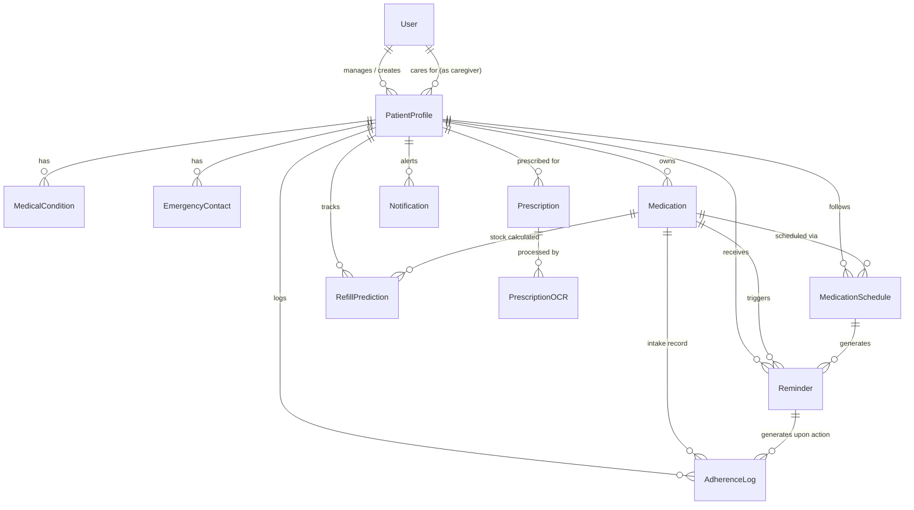

# PillSync Database Schema Documentation

This document defines the complete relational database schema for the **PillSync Intelligent Medicine Reminder and Medication Tracking Platform**, running on **PostgreSQL 16** in production/CI with transparent fallback to **SQLite 3** in local development.

---

## 1. Entity-Relationship (ER) Overview

---

## 2. Table Specifications

### 2.1 `accounts_user` (Custom User Model)
Inherits from Django's `AbstractUser`, serving as the core identity entity for authentication and Role-Based Access Control (RBAC).

| Column | Type | Constraints | Description |
|---|---|---|---|
| `id` | BigAutoField / Integer | PRIMARY KEY | Unique user ID |
| `username` | Varchar(150) | UNIQUE, NOT NULL | Account login identifier |
| `email` | Varchar(254) | NOT NULL | User contact email address |
| `password` | Varchar(128) | NOT NULL | Argon2 / PBKDF2 hashed password |
| `first_name` | Varchar(150) | NULL | User given name |
| `last_name` | Varchar(150) | NULL | User family surname |
| `role` | Varchar(20) | NOT NULL, DEFAULT 'PATIENT' | `PATIENT`, `CAREGIVER`, or `ADMIN` |
| `phone` | Varchar(20) | NULL | Mobile phone for SMS notifications |
| `is_staff` | Boolean | NOT NULL, DEFAULT False | Django staff access flag |
| `is_superuser` | Boolean | NOT NULL, DEFAULT False | Admin superuser privileges |
| `is_active` | Boolean | NOT NULL, DEFAULT True | Soft-deletion flag |
| `date_joined` | DateTime | NOT NULL | Account creation timestamp |
| `last_login` | DateTime | NULL | Last authenticated timestamp |

---

### 2.2 `profiles_patientprofile`
Represents an individual patient profile. Enables multi-profile family support under a single account.

| Column | Type | Constraints | Description |
|---|---|---|---|
| `id` | BigAutoField | PRIMARY KEY | Profile ID |
| `user_id` | BigInteger | FK(`accounts_user.id`), NULL, CASCADE | Account owner |
| `caregiver_id` | BigInteger | FK(`accounts_user.id`), NULL, SET_NULL | Assigned caregiver user |
| `name` | Varchar(100) | NOT NULL | Patient full name |
| `relationship` | Varchar(50) | NOT NULL, DEFAULT 'Self' | `Self`, `Spouse`, `Child`, `Parent`, `Sibling`, `Other` |
| `dob` | Date | NULL | Date of birth |
| `gender` | Varchar(20) | DEFAULT 'Unspecified' | Gender identity |
| `phone` | Varchar(20) | NULL | Patient phone number |
| `email` | Varchar(254) | NULL | Patient personal email |
| `address` | Text | NULL | Residential address |
| `medical_conditions` | Text | DEFAULT '' | Comma-separated or descriptive conditions |
| `allergies` | Text | DEFAULT '' | Known allergies and drug sensitivities |
| `emergency_contact_name` | Varchar(100) | DEFAULT '' | Primary emergency contact name |
| `emergency_contact_phone`| Varchar(20) | DEFAULT '' | Primary emergency contact phone |
| `is_primary` | Boolean | DEFAULT False | Primary account profile indicator |
| `created_at` | DateTime | NOT NULL, auto_now_add | Profile creation timestamp |
| `updated_at` | DateTime | NOT NULL, auto_now | Last modified timestamp |

---

### 2.3 `profiles_medicalcondition`
Normalized diagnoses and clinical conditions linked to patient profiles.

| Column | Type | Constraints | Description |
|---|---|---|---|
| `id` | BigAutoField | PRIMARY KEY | Condition ID |
| `patient_profile_id` | BigInteger | FK(`profiles_patientprofile.id`), CASCADE | Associated patient |
| `name` | Varchar(150) | NOT NULL | Condition name (e.g. Hypertension) |
| `diagnosed_date` | Date | NULL | Date diagnosed |
| `severity` | Varchar(50) | DEFAULT 'Moderate' | Severity scale (Mild, Moderate, Severe) |
| `notes` | Text | DEFAULT '' | Clinical physician notes |
| `created_at` | DateTime | NOT NULL | Record creation timestamp |

---

### 2.4 `profiles_emergencycontact`
Detailed emergency contacts and priority escalation numbers.

| Column | Type | Constraints | Description |
|---|---|---|---|
| `id` | BigAutoField | PRIMARY KEY | Contact ID |
| `patient_profile_id` | BigInteger | FK(`profiles_patientprofile.id`), CASCADE | Associated patient |
| `name` | Varchar(100) | NOT NULL | Contact name |
| `relationship` | Varchar(50) | DEFAULT 'Family' | Relationship to patient |
| `phone` | Varchar(20) | NOT NULL | Emergency phone number |
| `email` | Varchar(254) | NULL | Emergency email |
| `is_primary` | Boolean | DEFAULT False | High-priority escalation target |
| `created_at` | DateTime | NOT NULL | Record creation timestamp |

---

### 2.5 `medications_medication`
Medication catalog and active patient medicine entries.

| Column | Type | Constraints | Description |
|---|---|---|---|
| `id` | BigAutoField | PRIMARY KEY | Medicine ID |
| `patient_profile_id` | BigInteger | FK(`profiles_patientprofile.id`), CASCADE | Profile owner |
| `name` | Varchar(150) | NOT NULL | Medication trade / generic name |
| `dosage` | Varchar(50) | NOT NULL | Strength (e.g. 500mg, 10ml) |
| `form` | Varchar(50) | NOT NULL | Formulation: Tablet, Capsule, Syrup, Injection |
| `disease_category` | Varchar(100) | DEFAULT 'General' | Therapeutic class / category |
| `instructions` | Text | DEFAULT '' | Meal timing: Before meals, With food, etc. |
| `stock_quantity` | Integer | DEFAULT 0 | Current remaining pills / doses |
| `is_active` | Boolean | DEFAULT True | Active prescription flag |
| `created_at` | DateTime | NOT NULL | Record creation timestamp |
| `updated_at` | DateTime | NOT NULL | Last modified timestamp |

---

### 2.6 `medications_medicationschedule`
Dosage schedules specifying administration times and frequencies.

| Column | Type | Constraints | Description |
|---|---|---|---|
| `id` | BigAutoField | PRIMARY KEY | Schedule ID |
| `medication_id` | BigInteger | FK(`medications_medication.id`), CASCADE | Target medication |
| `patient_profile_id` | BigInteger | FK(`profiles_patientprofile.id`), CASCADE | Target patient |
| `frequency` | Varchar(50) | DEFAULT 'Daily' | Daily, Weekly, As-Needed |
| `time_of_day` | Varchar(50) | DEFAULT 'Morning' | Morning, Afternoon, Evening, Night |
| `specific_time` | Time | DEFAULT '08:00:00' | Exact scheduled dose time |
| `quantity_per_dose` | Decimal(5,2)| DEFAULT 1.00 | Number of units per intake |
| `start_date` | Date | NOT NULL | Schedule commencement date |
| `end_date` | Date | NULL | Schedule completion date |
| `is_active` | Boolean | DEFAULT True | Active scheduling status |

---

### 2.7 `prescriptions_prescription`
Physical or digital medical prescriptions uploaded for OCR ingestion and archiving.

| Column | Type | Constraints | Description |
|---|---|---|---|
| `id` | BigAutoField | PRIMARY KEY | Prescription ID |
| `patient_profile_id` | BigInteger | FK(`profiles_patientprofile.id`), CASCADE | Associated patient |
| `doctor_name` | Varchar(120) | NOT NULL | Prescribing physician name |
| `clinic_name` | Varchar(150) | DEFAULT '' | Hospital or clinic facility |
| `issue_date` | Date | NOT NULL | Date prescribed |
| `expiry_date` | Date | NULL | Expiration date of prescription |
| `file_url` | Varchar(500) | DEFAULT '' | URI or file path to prescription document |
| `notes` | Text | DEFAULT '' | Pharmacy dispensing instructions |
| `ocr_status` | Varchar(30) | DEFAULT 'PENDING' | PENDING, PROCESSED, FAILED |
| `ocr_data` | JSONB / JSON | DEFAULT '{}' | Structured medicine extraction results |
| `created_at` | DateTime | NOT NULL | Upload timestamp |
| `updated_at` | DateTime | NOT NULL | Last modified timestamp |

---

### 2.8 `reminders_reminder`
Generated reminder instances for scheduled medicine doses.

| Column | Type | Constraints | Description |
|---|---|---|---|
| `id` | BigAutoField | PRIMARY KEY | Reminder ID |
| `patient_profile_id` | BigInteger | FK(`profiles_patientprofile.id`), CASCADE | Recipient patient |
| `medication_id` | BigInteger | FK(`medications_medication.id`), CASCADE | Prescribed medicine |
| `schedule_id` | BigInteger | FK(`medications_medicationschedule.id`), NULL, SET_NULL | Generating schedule |
| `scheduled_time` | DateTime | NOT NULL | Target alert timestamp |
| `status` | Varchar(20) | NOT NULL, DEFAULT 'PENDING' | `PENDING`, `TAKEN`, `MISSED`, `SNOOZED` |
| `snoozed_until` | DateTime | NULL | Timestamp if snoozed |
| `action_time` | DateTime | NULL | Exact timestamp patient responded |
| `created_at` | DateTime | NOT NULL | Generation timestamp |

---

### 2.9 `adherence_adherencelog`
Audit trail of medicine consumption events used for adherence analytics and doctor reports.

| Column | Type | Constraints | Description |
|---|---|---|---|
| `id` | BigAutoField | PRIMARY KEY | Log entry ID |
| `patient_profile_id` | BigInteger | FK(`profiles_patientprofile.id`), CASCADE | Patient profile |
| `medication_id` | BigInteger | FK(`medications_medication.id`), CASCADE | Medication |
| `reminder_id` | BigInteger | FK(`reminders_reminder.id`), NULL, SET_NULL | Associated reminder |
| `action` | Varchar(20) | NOT NULL | `TAKEN`, `MISSED`, `SNOOZED` |
| `scheduled_time` | DateTime | NOT NULL | Scheduled dose time |
| `recorded_at` | DateTime | NOT NULL, auto_now_add | When log entry occurred |
| `notes` | Text | DEFAULT '' | Patient or caregiver remarks |

---

### 2.10 `refills_refillprediction`
AI refill forecasting engine outputs tracking pill inventory and depletion dates.

| Column | Type | Constraints | Description |
|---|---|---|---|
| `id` | BigAutoField | PRIMARY KEY | Prediction ID |
| `patient_profile_id` | BigInteger | FK(`profiles_patientprofile.id`), CASCADE | Patient profile |
| `medication_id` | BigInteger | FK(`medications_medication.id`), CASCADE | Medication |
| `current_stock` | Integer | NOT NULL | Remaining pills |
| `daily_consumption` | Decimal(5,2)| NOT NULL | Daily required dose units |
| `predicted_depletion_date` | Date | NOT NULL | Calculated zero-stock date |
| `recommended_refill_date` | Date | NOT NULL | Depletion date minus 5-day lead buffer |
| `is_low_stock` | Boolean | DEFAULT False | Flag set when stock <= 5 days |
| `last_calculated_at` | DateTime | NOT NULL | Algorithm evaluation timestamp |

---

### 2.11 `notifications_notification`
Multi-channel notification inbox (push, SMS, email, caregiver escalation).

| Column | Type | Constraints | Description |
|---|---|---|---|
| `id` | BigAutoField | PRIMARY KEY | Notification ID |
| `patient_profile_id` | BigInteger | FK(`profiles_patientprofile.id`), CASCADE | Target patient |
| `title` | Varchar(200) | NOT NULL | Notification title |
| `message` | Text | NOT NULL | Message body |
| `notification_type` | Varchar(50) | DEFAULT 'REMINDER' | `REMINDER`, `REFILL`, `LOW_STOCK`, `CAREGIVER_ALERT` |
| `channel` | Varchar(30) | DEFAULT 'IN_APP' | `IN_APP`, `PUSH`, `SMS`, `EMAIL` |
| `is_read` | Boolean | DEFAULT False | Read state |
| `sent_at` | DateTime | NOT NULL, auto_now_add | Sent timestamp |

---

### 2.12 `ocr_prescriptionocr`
Optical Character Recognition processing records for prescription label ingestion.

| Column | Type | Constraints | Description |
|---|---|---|---|
| `id` | BigAutoField | PRIMARY KEY | OCR Job ID |
| `patient_profile_id` | BigInteger | FK(`profiles_patientprofile.id`), CASCADE | Patient profile |
| `image_file` | File / Char(500)| NOT NULL | Uploaded image path |
| `raw_text` | Text | DEFAULT '' | Extracted raw text from Tesseract |
| `extracted_data` | JSONB / JSON | DEFAULT '{}' | Parsed name, dosage, quantity, frequency |
| `confidence` | Decimal(5,2)| DEFAULT 0.00 | Recognition confidence score |
| `status` | Varchar(30) | DEFAULT 'COMPLETED' | `PENDING`, `COMPLETED`, `FAILED` |
| `created_at` | DateTime | NOT NULL | Processing timestamp |

---

## 3. Database Migrations Status

All Django applications include finalized initial migrations in `apps/*/migrations/0001_initial.py`:

| Application | Migration File | Status |
|---|---|---|
| `apps.accounts` | `0001_initial.py` | Verified & Applied |
| `apps.profiles` | `0001_initial.py`, `0002_*.py` | Verified & Applied |
| `apps.medications` | `0001_initial.py` | Verified & Applied |
| `apps.prescriptions` | `0001_initial.py` | Verified & Applied |
| `apps.reminders` | `0001_initial.py` | Verified & Applied |
| `apps.adherence` | `0001_initial.py` | Verified & Applied |
| `apps.refills` | `0001_initial.py` | Verified & Applied |
| `apps.analytics` | `0001_initial.py` | Verified & Applied |
| `apps.ocr` | `0001_initial.py` | Verified & Applied |
| `apps.notifications` | `0001_initial.py` | Verified & Applied |
| `rest_framework_simplejwt.token_blacklist` | `0001_initial.py` to `0012_*.py` | Verified & Applied |
