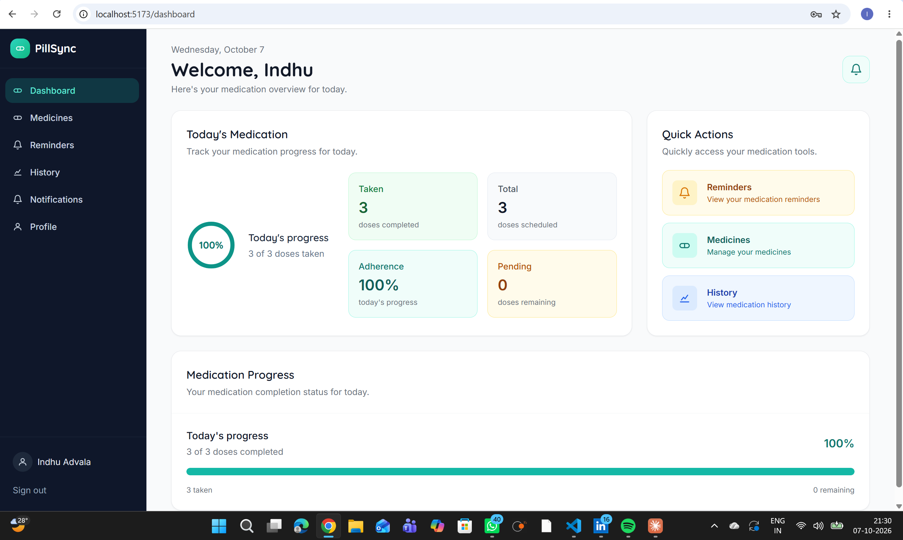
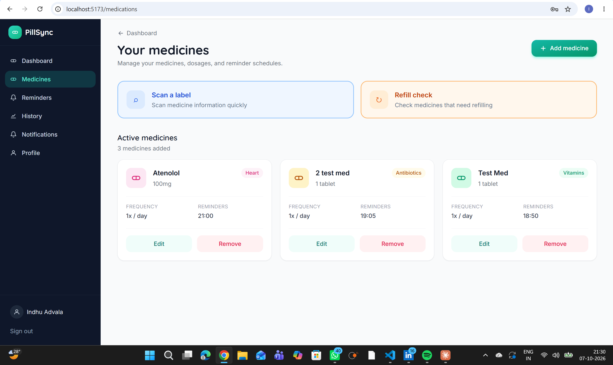
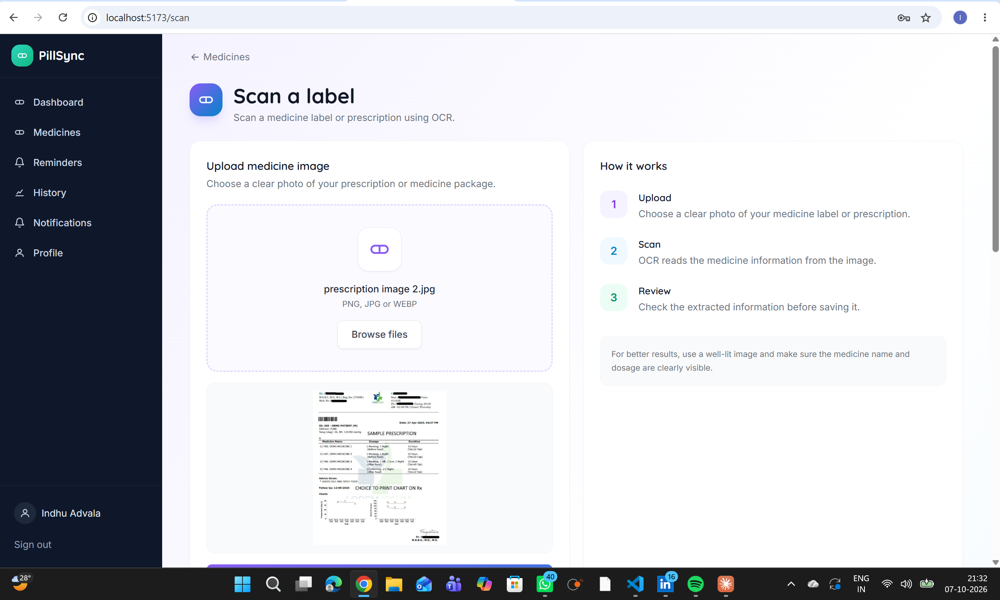
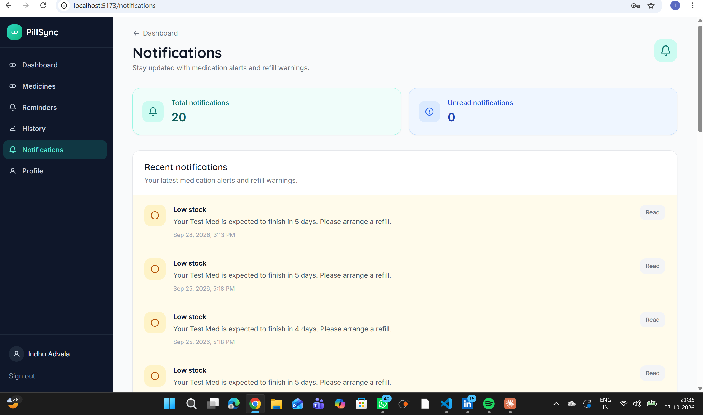
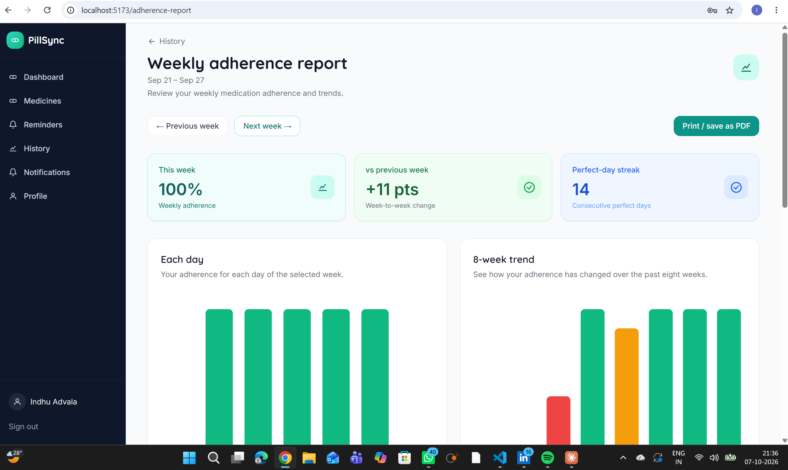

# PillSync Demo

**Live app:** https://pillsync-frontend-cltn.onrender.com

The app runs on free hosting, so the first load can take up to a minute while the backend wakes up. Demo accounts (patient, caregiver, admin) are shared with the mentor privately; credentials are not stored in this repository.

## Screenshots

Captured on 7 October 2026 from the local build of the same code that is deployed at the link above.

| # | Screen | What it shows |
|---|---|---|
| 1 | Patient dashboard | Today's medication: 3 of 3 doses taken, 100% adherence, 0 pending, and quick actions |
| 2 | Your medicines | Three active medicines with category, dose, frequency and reminder time, plus the Scan a label and Refill check shortcuts |
| 3 | Scan a label | A prescription image selected for OCR upload, with the Upload, Scan, Review guide |
| 4 | Notifications | 20 notifications with low-stock refill warnings |
| 5 | Weekly adherence report | 100% weekly adherence, +11 points against the previous week, a 14-day perfect streak, the daily chart and the 8-week trend |

## Demonstration flow

### Patient

1. Sign in and open the **Dashboard** (today's doses and progress).
2. Open **Medicines** to view, add, edit or remove medicines and their reminder times.
3. Choose **Scan a label**, upload a prescription image and review the extracted medicines before saving.
4. Mark doses as taken from the dashboard or **Reminders**.
5. Open **Refill check** (from Medicines) to see how many days of stock are left.
6. Open **Notifications** for low-stock and reminder alerts.
7. Open **History**, then the **Weekly adherence report** for the weekly percentage, the 8-week trend and the streak (it can also be printed or saved as PDF).

### Caregiver

1. Sign in as the caregiver.
2. Open the caregiver dashboard and the linked patient.
3. Review the patient's adherence information.

### Admin

1. Sign in as the admin.
2. Open the admin dashboard and then **OCR monitoring** to see scan totals, sources and recent scans.

## Evidence

Screenshots above, plus a live demonstration to the mentor on the deployed app. Screenshots from the deployed site (OCR scan result, refill page, caregiver view, admin OCR monitoring) can be added on request.