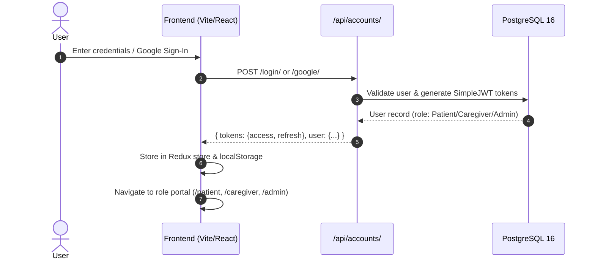
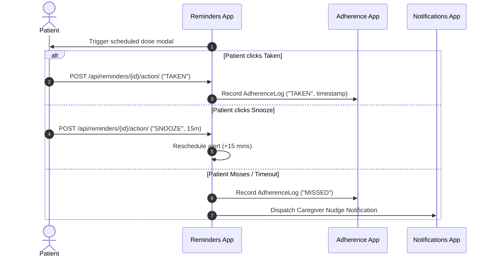

# PillSync — UI Wireframes and Workflow Planning Specification

**Platform:** PillSync — Intelligent Medicine Reminder and Medication Tracking Platform  
**Target Roles:** Patient, Caregiver, Administrator  
**Design Tokens:** Crimson Primary (`#ED4264`), Ruby Accent (`#DC143C`), Neutral Light (`#FFF0F3`)  
**Companion Documents:**
- [UI_WIREFRAMES.md](file:///c:/Users/rajas/OneDrive/PillSync/docs/wireframes/UI_WIREFRAMES.md) (25-Screen Layout Blueprints)
- [WORKFLOW_PLANNING.md](file:///c:/Users/rajas/OneDrive/PillSync/docs/architecture/WORKFLOW_PLANNING.md) (End-to-End System Sequence & Workflow Flowcharts)

---

## 1. Design System & Tokens

### Color Palette
- **Primary Brand:** Crimson `#ED4264` to Ruby `#DC143C`
- **Surface Background:** Warm Neutral `#FCF8F9`, Card White `#FFFFFF`, Card Highlight `#FFF0F3`
- **Action & Status Colors:**
  - Taken / Completed: Emerald `#16A34A`
  - Snoozed: Amber `#D97706`
  - Missed / Alert: Rose Crimson `#DC2626`
  - Pending / Upcoming: Royal Blue `#2563EB`
- **Typography:** Inter, system-ui, sans-serif

---

## 2. Information Architecture & Navigation

```
PillSync Navigation Shell
├── Public / Auth
│   ├── Landing / Role Selection (/)
│   ├── Login (/login, /login/patient, /login/caregiver, /login/admin)
│   ├── Register (/register, /register/patient, /register/caregiver)
│   ├── Password Reset (/forgot-password)
│   └── OAuth Google Token Exchange
├── Patient Portal (/patient)
│   ├── Dashboard & Schedule Portal
│   ├── My Medicines & Add Medicine (/patient/medicines, /patient/add-medicine)
│   ├── Prescriptions & OCR Scan (/patient/prescriptions, /ocr/upload)
│   ├── Adherence Analytics & History (/patient/adherence, /patient/history)
│   ├── Refill Predictions & Alerts (/patient/refills)
│   ├── Notifications (/patient/notifications)
│   └── Multi-Profile Management (/profile)
├── Caregiver Portal (/caregiver)
│   ├── Caregiver Monitored Patients Dashboard
│   ├── Patient Detail & Daily Schedule Inspection
│   ├── Adherence Reports & Escalated Missed Doses
│   └── Refill Alerts & Emergency Contact Triggers
└── Admin Console (/admin)
    ├── Platform Metric Overview
    ├── User & Role Management (/admin/users)
    ├── Notification Broadcast Configuration (/admin/notifications)
    └── Global Adherence & System Health
```

---

## 3. Core Wireframe Layouts

### 3.1 Role Selection Landing Page (`/`)
```
+-------------------------------------------------------------------------------+
|  PillSync                        [Patient Login] [Caregiver Login] [Admin]    |
+-------------------------------------------------------------------------------+
|                                                                               |
|            Intelligent Medication Management Platform                         |
|            Never miss a dose. AI Refills. Real-time Adherence Tracking.       |
|                                                                               |
|   +-----------------------+ +-----------------------+ +---------------------+ |
|   |   PATIENT PORTAL      | |   CAREGIVER PORTAL    | |   ADMIN CONSOLE     | |
|   |                       | |                       | |                     | |
|   |  * Daily Dose Alert   | |  * Monitor Loved Ones | |  * System Analytics | |
|   |  * Family Profiles    | |  * Missed Dose Alert  | |  * User Management  | |
|   |  * OCR Prescription   | |  * Refill Warnings    | |  * Audit Logs       | |
|   |  * Refill Prediction  | |  * Health History     | |  * Notification Hub | |
|   |                       | |                       | |                     | |
|   |   [ Enter Portal ]    | |   [ Enter Portal ]    | |  [ Admin Access ]   | |
|   +-----------------------+ +-----------------------+ +---------------------+ |
|                                                                               |
+-------------------------------------------------------------------------------+
```

### 3.2 Patient Dashboard (`/patient`)
```
+-------------------------------------------------------------------------------+
| PillSync | [Family Profile: John Doe (Self) v]       (Bell) 3  [Logout]       |
+-------------------+-----------------------------------------------------------+
| [Dashboard]       | Good morning, John! Here is today's schedule.             |
| [My Medicines]    | +--------------------+ +-------------------+ +----------+ |
| [Schedule]        | | Adherence: 94%     | | Upcoming: 2 Doses | | Refills:1| |
| [Prescriptions]   | +--------------------+ +-------------------+ +----------+ |
| [Adherence]       |                                                           |
| [Refills]         | Today's Medication Schedule:                              |
| [History]         | +-------------------------------------------------------+ |
| [Profile]         | | 08:00 AM - Metformin 500mg (1 Tablet with breakfast)  | |
|                   | | Status: TAKEN at 08:05 AM                   [Recorded]| |
|                   | +-------------------------------------------------------+ |
|                   | | 01:00 PM - Lisinopril 10mg (1 Tablet with lunch)      | |
|                   | | Status: DUE NOW             [Take] [Snooze] [Miss]    | |
|                   | +-------------------------------------------------------+ |
|                   | | 08:00 PM - Atorvastatin 20mg (1 Tablet at bedtime)    | |
|                   | | Status: UPCOMING                                      | |
|                   | +-------------------------------------------------------+ |
+-------------------+-----------------------------------------------------------+
```

### 3.3 Reminder Dose Interaction Modal
```
+---------------------------------------------------------+
|                  MEDICATION REMINDER                    |
|                                                         |
|    Time for your dose:                                  |
|    Lisinopril 10mg - 1 Tablet                           |
|    Instructions: Take with water after food             |
|                                                         |
|    Scheduled for: 01:00 PM (10 mins ago)                |
|                                                         |
|    +----------------+ +----------------+ +------------+ |
|    |   [TAKEN]      | |  [SNOOZE 15M]  | |  [MISSED]  | |
|    | (Record intake)| | (Remind later) | | (Log miss) | |
|    +----------------+ +----------------+ +------------+ |
+---------------------------------------------------------+
```

### 3.4 Multi-Profile Family Manager (`/profile`)
```
+-------------------------------------------------------------------------------+
| Profiles & Family Accounts                               [ + Add Family Member ]
+-------------------------------------------------------------------------------+
| Active Context: [ John Doe (Self) - Primary ]                                 |
|                                                                               |
| Family Member Roster:                                                         |
| +-------------------------+ +-------------------------+ +-------------------+ |
| | John Doe                | | Jane Doe                | | Robert Doe        | |
| | Relationship: Self      | | Relationship: Spouse    | | Relationship:Father|
| | DOB: 1985-04-12         | | DOB: 1987-09-21         | | DOB: 1952-11-04   | |
| | Allergies: Penicillin   | | Conditions: Asthma      | | Conditions: HTN   | |
| | [Active Primary]        | | [Switch Context] [Edit] | | [Switch] [Edit]   | |
| +-------------------------+ +-------------------------+ +-------------------+ |
|                                                                               |
| Clinical Conditions & Emergency Contacts:                                     |
| Emergency Contact: Mary Doe (Mother) - +1 555-019-2834 (Primary Escalation)   |
| Secondary Contact: Clinic Helpline - +1 555-492-0012                          |
+-------------------------------------------------------------------------------+
```

---

## 4. System Workflow Diagrams

### 4.1 Authentication & RBAC Authorization Flow


### 4.2 Reminder & Intake Logging Lifecycle


---

## 5. Responsive Design Breakpoints

| Breakpoint | Target Screen | Layout Strategy |
|---|---|---|
| `sm` (< 640px) | Mobile portrait | Single column, bottom sticky dose bar, drawer menu |
| `md` (640px – 1024px) | Tablets & iPad | Collapsible sidebar, 2-column dashboard card grid |
| `lg` (> 1024px) | Desktop & Web | Full persistent sidebar, 3-card role layout, charts |

All components are styled using Tailwind CSS tokens and custom brand variables.
